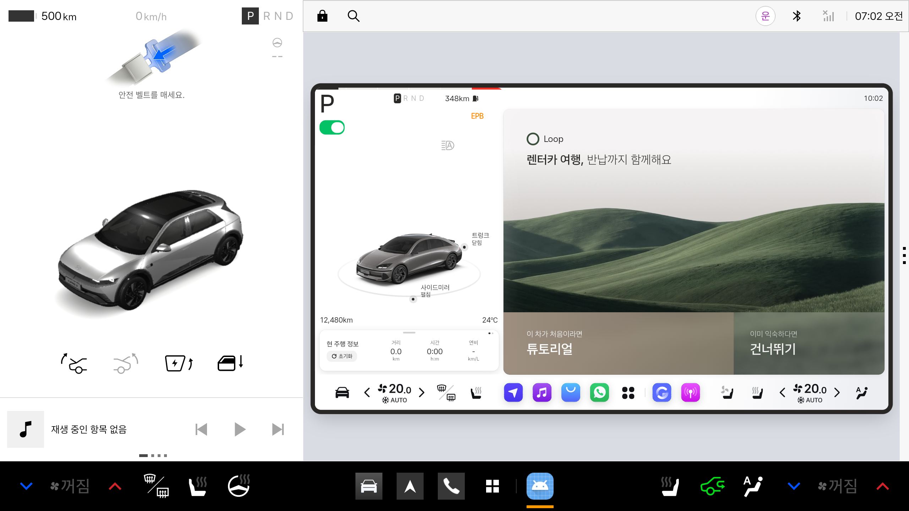

# Loop — 제주 렌터카 여행 동반 차량 앱

2026 현대자동차그룹 **Pleos Connect** 앱 공모전 출품작 프로토타입.

렌터카를 빌린 순간부터 반납할 때까지, 차 안에서 여행 일정·경로·반납 준비를 함께하는 차량 인포테인먼트 앱입니다.

> 이 저장소는 **화면 프로토타입**입니다. 차량 데이터(좌석 센서·연료·주행 상태·내비)는 시뮬레이션이며, Pleos SDK 연동은 포함하지 않습니다.

## 주요 기능
- **튜토리얼** — Driving View와 Loop 창의 역할을 미니 화면으로 안내
- **여행 설정** — 숙소, 반납 일정·지점, 동승자(좌석 센서·카시트), 여행 취향
- **취향 분석** — 고른 취향을 다이어그램으로 보여주고 키워드 추출
- **전체 일정** — 1일차부터 반납일까지 일차별 장소(추천대로 / 자유롭게), 3일 이상이면 숙소 변경
- **길 취향** — 멀미 적게 / 풍경 / 조용하게 / 빠르게 (아이 탑승 시 멀미 적은 길 추천)
- **주행 중 제안** — 비·정체 등 상황에 맞춘 경로 변경 제안과 음성 안내
- **반납 준비** — 남은 시간 계산(여유/빠듯), 한 곳 더 들르기, 주유소 안내, 반납 전 체크리스트
- **반납 완료** — 여행 기록 요약, QR로 가져가기, 기록 지우고 마치기

## APK
- 위치: [`apk/루프_Loop_release.apk`](apk/) (release 빌드)

## 실행 방법
1. `apk/` 폴더의 APK를 기기(또는 에뮬레이터)에 설치
   ```bash
   adb install -r apk/루프_Loop_release.apk
   ```
2. 앱 실행 → 첫 화면에서 **튜토리얼**(처음 사용) 또는 **건너뛰기**를 누르면 시작되고, 첫 터치 후부터 음성 안내가 나옵니다
3. 인터넷 연결 없이 동작합니다 (폰트·라이브러리·지도 데이터 모두 앱에 포함)

## 테스트 환경 및 필요한 설정
- 테스트 기기: Pleos Connect Emulator v2.1.0 (Android Studio AVD, API 34, arm64, RAM 4GB, Cold boot)
- 화면: 가로 2560×1440, 앱 창 안에서 디자인 기준 1280×720을 비율 유지로 맞춰 표시
- Android: 9 (API 28) 이상, targetSdk 35
- 음성 안내가 안 나오면: 설정 → 텍스트 음성 변환(TTS) → Google TTS 한국어 음성 데이터 설치
- 차량 데이터(좌석 센서·연료·주행 상태·내비)는 앱 안에서 시뮬레이션되므로 별도 설정 불필요

## Pleos Connect 에뮬레이터
- 버전: **Pleos Connect Emulator v2.1.0** (`system-images;android-34;pleos_car_emulator;arm64-v8a`, 빌드 `release_connect_v2.1.0`)
- 화면 규격: 2560×1440 가로, 12.8인치, density 160 (mdpi) — 기기 정의 "Pleos Connect v2.1.0"
- 설치: [Pleos Connect Emulator 설치 및 실행](https://document.pleos.ai/docs/connect/guide/getting-started/application-development/setup-connect-sdk-emulator)

## 스크린샷
Pleos Connect Emulator v2.1.0에서 실행한 첫 화면



## 시연 영상
(링크 추가 예정)

## 빌드
```bash
./gradlew assembleRelease
# → app/build/outputs/apk/release/app-release.apk
```
화면 원본은 `web/loop.html`. 수정 후 `tools/sync-web.sh`로 앱 자산에 반영.

## 구조
| 경로 | 내용 |
|---|---|
| `web/` | 화면 원본 (HTML/CSS/JS 단일 파일 + 이미지·지도 데이터) |
| `app/` | 안드로이드 앱 (전체화면 WebView + 안드로이드 TTS 연결) |
| `docs/` | 화면 흐름·디자인 문서 |
| `tools/` | web → app 동기화 스크립트 |

## 데이터 출처
- 도로 데이터: © OpenStreetMap contributors (ODbL)
